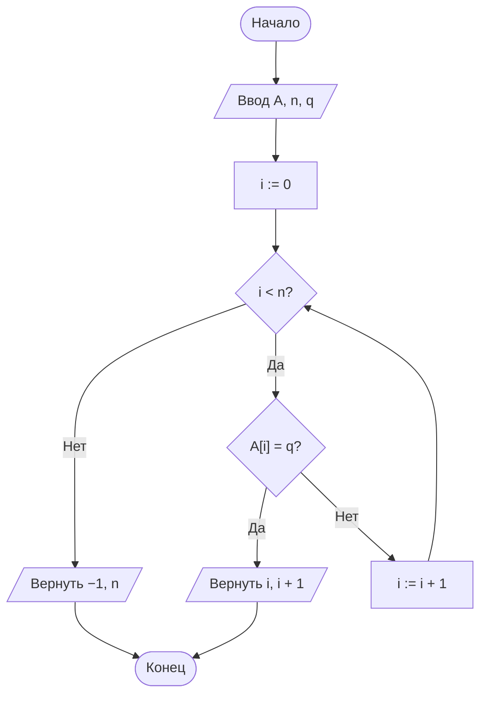
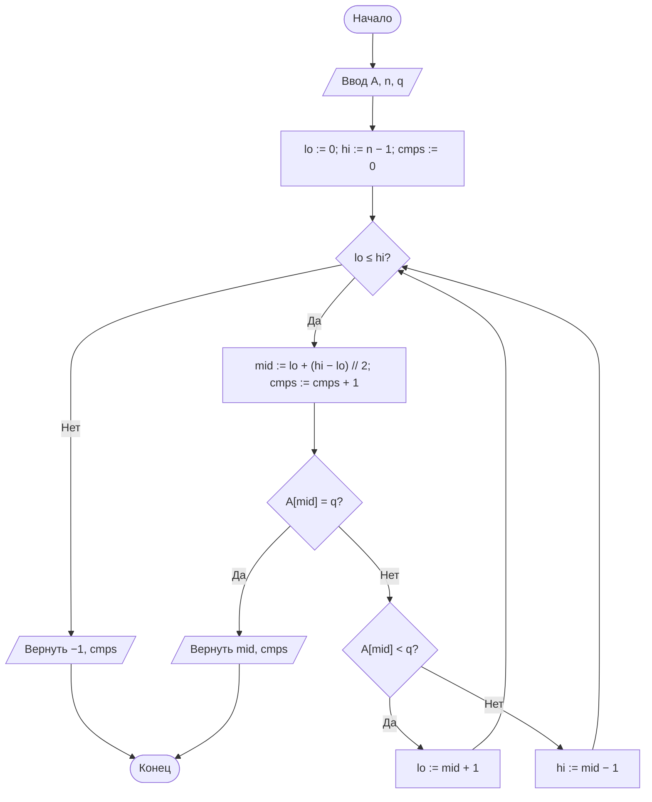
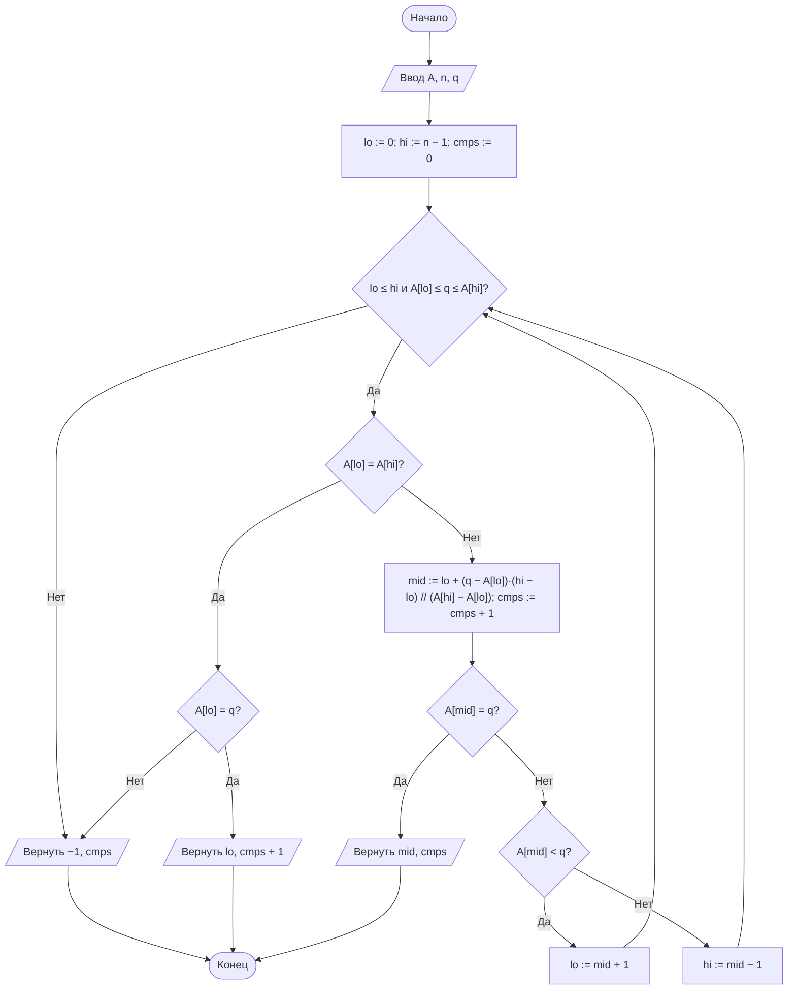
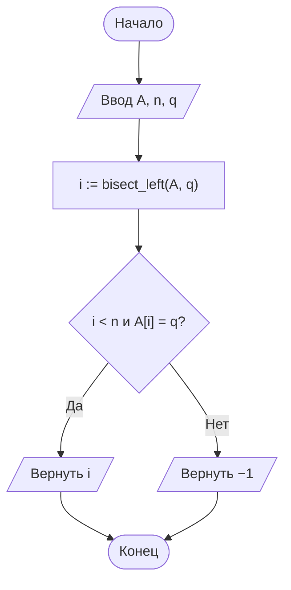

# Отчёт по лабораторной работе № 4

## Анализ алгоритмов последовательного, двоичного и интерполяционного поиска

---

## 1. Титульный лист

| | |
|---|---|
| **Дисциплина** | Теория алгоритмов |
| **Направление подготовки** | 38.03.05 «Бизнес-информатика» |
| **Курс** | 2 |
| **Лабораторная работа** | № 4. Анализ алгоритмов последовательного, двоичного и интерполяционного поиска |
| **Вариант** | 19 |
| **Выполнила** | Ситникова Ольга, группа БИ2-1 |
| **Проверил** | ______________________ |
| **Год** | 2026 |

---

## 2. Цель работы и задание варианта

**Цель работы:** изучить алгоритмы поиска элемента в массиве, экспериментально сопоставить их трудоёмкость с теоретическими оценками и определить условия, при которых предварительная сортировка данных оправдана.

**Задание варианта 19:**

| Параметр | Значение |
|---|---|
| Размеры массива $n$ | $10^4$, $10^5$, $10^6$ |
| Распределение ключей | А — арифметическая прогрессия $A[i] = c + d \cdot i$ (в работе $c = 5$, $d = 7$) |
| Число запросов $k$ | 1000 |
| Тип запросов | успешные (ключ всегда есть в массиве) |
| Дополнительное задание | Б5 — сравнить собственную реализацию двоичного поиска со стандартным модулем `bisect` и объяснить разницу во времени |

Необходимо реализовать последовательный, двоичный и интерполяционный поиск (каждая функция возвращает пару «индекс или −1, число сравнений»), измерить среднее время одного запроса и среднее число сравнений, построить графики с логарифмической шкалой по оси $n$ и сопоставить результаты с теорией.

---

## 3. Описание алгоритмов и теоретические оценки

Дан массив $A$ из $n$ элементов и ключ $q$. Требуется найти индекс $i$, для которого $A[i] = q$, либо установить, что такого элемента нет.

### 3.1. Последовательный (линейный) поиск

Элементы просматриваются подряд до совпадения либо до конца массива. Упорядоченность данных не требуется. При успешном поиске с равновероятным положением ключа среднее число сравнений:

$$C_{\text{ср}} = \frac{1 + 2 + \ldots + n}{n} = \frac{n + 1}{2} = \Theta(n).$$

При неуспешном поиске всегда выполняется $n$ сравнений.

### 3.2. Двоичный поиск

Применим только к **упорядоченному** массиву. Сравнивается средний элемент отрезка, после чего поиск продолжается в левой или правой половине. Длина отрезка уменьшается вдвое после каждого сравнения, поэтому в худшем случае

$$C_{\max} = \lfloor \log_2 n \rfloor + 1 = \Theta(\log n).$$

Для успешного поиска среднее число сравнений близко к $\log_2 n - 1$.

### 3.3. Интерполяционный поиск

Вместо середины отрезка вычисляется ожидаемая позиция ключа в предположении равномерного распределения значений:

$$mid = lo + \left\lfloor \frac{(q - A[lo]) \cdot (hi - lo)}{A[hi] - A[lo]} \right\rfloor.$$

Для равномерно распределённых ключей число сравнений равно $O(\log \log n)$, для произвольных (например, степенных или кластеризованных) — до $O(n)$. Для арифметической прогрессии (распределение «А» из варианта) формула даёт **точную** позицию, поэтому теоретически достаточно одного сравнения.

### 3.4. Сводная таблица оценок

| Алгоритм | Упорядоченность | Лучший | Средний | Худший | Доп. память |
|---|---|---|---|---|---|
| Последовательный | Не требуется | $\Theta(1)$ | $\Theta(n)$ | $\Theta(n)$ | $O(1)$ |
| Двоичный | Требуется | $\Theta(1)$ | $\Theta(\log n)$ | $\Theta(\log n)$ | $O(1)$ |
| Интерполяционный | Требуется | $\Theta(1)$ | $\Theta(\log \log n)$\* | $\Theta(n)$ | $O(1)$ |

\* При равномерном распределении ключей.

### 3.5. Поиск через модуль `bisect` (дополнительное задание Б5)

Функция `bisect.bisect_left(a, q)` возвращает индекс первого элемента, не меньшего $q$. Алгоритм тот же двоичный поиск, $\Theta(\log n)$, но реализован на языке C внутри интерпретатора. Чтобы получить результат поиска, после вызова проверяется равенство `a[i] == q`.

---

## 4. Блок-схемы алгоритмов

### 4.1. Последовательный поиск



### 4.2. Двоичный поиск



### 4.3. Интерполяционный поиск



### 4.4. Поиск через `bisect` (Б5)



---

## 5. Листинг программы

Файл `lab4_variant19.py` (Python 3.10+, для графиков нужна библиотека `matplotlib`). Каждая строка снабжена комментарием.

```python
"""Лабораторная работа № 4. Вариант 19. Ситникова Ольга, группа БИ2-1."""
import bisect  # стандартный модуль двоичного поиска (нужен для задания Б5)
import platform  # сведения о компьютере для раздела отчёта «Характеристики системы»
import random  # генерация случайных запросов
import time  # измерение времени работы
import matplotlib.pyplot as plt  # построение графиков

SIZES = [10**4, 10**5, 10**6]  # размеры массива n по варианту 19
K = 1000  # число запросов k по варианту 19 (все запросы успешные)
C, D = 5, 7  # параметры арифметической прогрессии A[i] = C + D * i (распределение «А»)


def linear_search(a, q):  # последовательный поиск: массив a, ключ q
    for i, v in enumerate(a):  # перебираем элементы по порядку вместе с их индексами
        if v == q:  # сравниваем текущий элемент с ключом
            return i, i + 1  # нашли: возвращаем индекс и число сравнений (оно равно i + 1)
    return -1, len(a)  # не нашли: индекс -1, выполнено n сравнений


def binary_search(a, q):  # двоичный поиск (массив должен быть упорядочен)
    lo, hi, cmps = 0, len(a) - 1, 0  # левая и правая границы отрезка, счётчик сравнений
    while lo <= hi:  # пока отрезок поиска не пуст
        mid = lo + (hi - lo) // 2  # берём середину отрезка (безопасная форма)
        cmps += 1  # считаем сравнение a[mid] с ключом
        if a[mid] == q:  # ключ найден в середине
            return mid, cmps  # возвращаем индекс и число сравнений
        if a[mid] < q:  # середина меньше ключа, значит ключ справа
            lo = mid + 1  # отбрасываем левую половину
        else:  # середина больше ключа, значит ключ слева
            hi = mid - 1  # отбрасываем правую половину
    return -1, cmps  # отрезок опустел, ключа нет


def interpolation_search(a, q):  # интерполяционный поиск (массив упорядочен)
    lo, hi, cmps = 0, len(a) - 1, 0  # границы отрезка и счётчик сравнений
    while lo <= hi and a[lo] <= q <= a[hi]:  # ключ должен лежать в диапазоне значений отрезка
        if a[lo] == a[hi]:  # все значения на отрезке одинаковы, делить на ноль нельзя
            cmps += 1  # одно сравнение с единственным значением
            return (lo, cmps) if a[lo] == q else (-1, cmps)  # нашли или нет
        mid = lo + (q - a[lo]) * (hi - lo) // (a[hi] - a[lo])  # ожидаемая позиция ключа
        cmps += 1  # считаем сравнение a[mid] с ключом
        if a[mid] == q:  # угадали позицию
            return mid, cmps  # возвращаем индекс и число сравнений
        if a[mid] < q:  # ключ правее ожидаемой позиции
            lo = mid + 1  # сдвигаем левую границу
        else:  # ключ левее ожидаемой позиции
            hi = mid - 1  # сдвигаем правую границу
    return -1, cmps  # ключ вне диапазона или не найден


def bisect_search(a, q):  # поиск через стандартный модуль bisect (задание Б5)
    i = bisect.bisect_left(a, q)  # индекс первого элемента, который не меньше q (код на языке C)
    return (i, 0) if i < len(a) and a[i] == q else (-1, 0)  # проверяем совпадение; сравнения не считаем


def make_data(n):  # генерация массива по варианту: арифметическая прогрессия
    return [C + D * i for i in range(n)]  # A[i] = C + D * i, массив сразу упорядочен


def benchmark(func, data, queries):  # замер среднего времени и среднего числа сравнений
    for q in queries[:20]:  # проверка правильности на первых 20 запросах
        assert data[func(data, q)[0]] == q  # найденный индекс должен указывать на ключ
    total = 0  # сумма сравнений по всем запросам
    start = time.perf_counter()  # засекаем время начала серии запросов
    for q in queries:  # выполняем все запросы подряд
        total += func(data, q)[1]  # прибавляем число сравнений текущего запроса
    elapsed = time.perf_counter() - start  # общее время серии
    return elapsed / len(queries), total / len(queries)  # среднее время одного запроса и среднее число сравнений


if __name__ == "__main__":  # запуск только при прямом старте файла
    print(platform.platform(), "|", platform.processor() or platform.machine(), "| Python", platform.python_version())  # система
    algos = {"Последовательный": linear_search, "Двоичный": binary_search,  # словарь алгоритмов: имя -> функция
             "Интерполяционный": interpolation_search, "bisect": bisect_search}  # bisect добавлен для Б5
    times = {name: [] for name in algos}  # сюда сложим время (мкс) по каждому n
    cmps = {name: [] for name in algos}  # сюда сложим число сравнений по каждому n
    rng = random.Random(1)  # генератор с фиксированным seed, чтобы результаты повторялись
    for n in SIZES:  # перебираем размеры массива
        data = make_data(n)  # строим массив из n элементов
        queries = [rng.choice(data) for _ in range(K)]  # K успешных запросов: случайные элементы массива
        print(f"\nn = {n}")  # заголовок блока результатов
        for name, func in algos.items():  # запускаем каждый алгоритм на одних и тех же запросах
            t, c = benchmark(func, data, queries)  # получаем среднее время и среднее число сравнений
            times[name].append(t * 1e6)  # переводим секунды в микросекунды и сохраняем
            cmps[name].append(c)  # сохраняем среднее число сравнений
            print(f"  {name:<18}{t * 1e6:>12.3f} мкс{c:>14.1f} сравнений")  # печатаем строку результата
    fig, (ax1, ax2) = plt.subplots(1, 2, figsize=(12, 4.5))  # два графика рядом
    for name in algos:  # рисуем линию для каждого алгоритма
        ax1.plot(SIZES, times[name], "o-", label=name)  # график времени от n
        if name != "bisect":  # у bisect число сравнений неизвестно, его не рисуем
            ax2.plot(SIZES, cmps[name], "o-", label=name)  # график числа сравнений от n
    for ax, title in ((ax1, "Среднее время запроса, мкс"), (ax2, "Среднее число сравнений")):  # оформление осей
        ax.set_xscale("log")  # логарифмическая шкала по оси n (требование задания)
        ax.set_yscale("log")  # логарифмическая шкала по оси y, т.к. значения различаются в тысячи раз
        ax.set_xlabel("n")  # подпись оси абсцисс
        ax.set_title(title)  # заголовок графика
        ax.grid(True, which="both", alpha=0.3)  # сетка для удобства чтения
        ax.legend()  # легенда с названиями алгоритмов
    plt.tight_layout()  # убираем наложение подписей
    plt.savefig("lab4_graphs.png", dpi=150)  # сохраняем график в файл для отчёта
    plt.show()  # показываем график на экране
```

---

## 6. Характеристики вычислительной системы

| Параметр | Значение |
|---|---|
| Операционная система | Linux (Ubuntu 24.04), ядро 6.18 |
| Процессор | Intel Xeon @ 2,10 ГГц (1 виртуальное ядро) |
| Оперативная память | 3 ГБ |
| Язык и версия | Python 3.12.3 |
| Библиотеки | matplotlib 3.11 |
| Способ измерения времени | `time.perf_counter()`, суммарное время 1000 запросов делится на 1000 |

---

## 7. Результаты измерений и графики

Массив строится как арифметическая прогрессия $A[i] = 5 + 7i$, запросов $k = 1000$, все успешные (случайные элементы массива, `seed = 1`). Время указано в микросекундах на один запрос.

**Таблица 1. Среднее время одного запроса, мкс**

| $n$ | Последовательный | Двоичный | Интерполяционный | `bisect` |
|---|---|---|---|---|
| $10^4$ | 137,349 | 1,146 | 0,219 | 0,291 |
| $10^5$ | 1415,186 | 2,055 | 0,301 | 0,480 |
| $10^6$ | 12 822,627 | 3,150 | 0,281 | 0,822 |

**Таблица 2. Среднее число сравнений на один запрос**

| $n$ | Последовательный | Теория $\frac{n+1}{2}$ | Двоичный | Теория $\log_2 n$ | Интерполяционный | Теория $\log_2\log_2 n$ |
|---|---|---|---|---|---|---|
| $10^4$ | 5053,3 | 5000,5 | 12,4 | 13,3 | 1,0 | 3,7 |
| $10^5$ | 50 720,8 | 50 000,5 | 15,8 | 16,6 | 1,0 | 4,1 |
| $10^6$ | 489 548,6 | 500 000,5 | 18,9 | 19,9 | 1,0 | 4,3 |

Для `bisect` число сравнений не подсчитывается, так как цикл выполняется внутри кода на C.

**Графики** (обе оси логарифмические; левый график — время, правый — число сравнений):


При росте $n$ в 100 раз (от $10^4$ до $10^6$) время последовательного поиска выросло примерно в 93 раза, двоичного — в 2,7 раза, а число сравнений двоичного поиска увеличилось с 12,4 до 18,9. Время интерполяционного поиска практически не изменилось (около 0,2–0,3 мкс).

---

## 8. Результат выполнения дополнительного задания Б5

Задание: сравнить собственную реализацию двоичного поиска со стандартным модулем `bisect` и объяснить разницу во времени.

**Таблица 3. Собственный двоичный поиск и `bisect`, мкс на запрос**

| $n$ | Собственный двоичный | `bisect` | Отношение времён |
|---|---|---|---|
| $10^4$ | 1,146 | 0,291 | 3,9 |
| $10^5$ | 2,055 | 0,480 | 4,3 |
| $10^6$ | 3,150 | 0,822 | 3,8 |

`bisect` быстрее собственной реализации примерно в 4 раза при всех размерах массива. Причины:

1. **Код на C вместо байт-кода.** Цикл `bisect_left` выполняется в скомпилированном модуле, а в собственной функции каждая итерация проходит через интерпретатор: выполняются десятки байт-кодовых инструкций, создаются временные целочисленные объекты, происходят обращения к переменным.
2. **Нет накладных расходов на подсчёт сравнений.** Наша функция на каждой итерации увеличивает счётчик `cmps` и возвращает кортеж, что `bisect` не делает.
3. **Быстрое сравнение элементов.** В C сравнение чисел выполняется напрямую, без повторных вычислений `a[mid]` и вызовов операторов на уровне Python (в нашей функции элемент `a[mid]` читается дважды за итерацию).

Асимптотика у обеих реализаций одинакова — $\Theta(\log n)$: отношение времён остаётся почти постоянным (3,8–4,3) при росте $n$ в 100 раз. Разница заключается в константном множителе, а не в порядке роста. Важно, что даже обёртка `bisect_search` добавляет вызов Python-функции и проверку `a[i] == q`, но всё равно оказывается быстрее.

---

## 9. Выводы

1. Экспериментальные данные подтверждают теоретические оценки. Среднее число сравнений последовательного поиска (5053, 50 721 и 489 549) близко к $\frac{n+1}{2}$; у двоичного поиска (12,4; 15,8; 18,9) оно близко к $\log_2 n - 1$, что соответствует теории для успешного поиска; интерполяционный поиск на арифметической прогрессии выполняет ровно одно сравнение.
2. Время последовательного поиска растёт пропорционально $n$ (при увеличении $n$ в 10 раз — примерно в 9–10 раз: 137 мкс → 1415 мкс → 12 823 мкс), а время двоичного — лишь на постоянную величину при каждом десятикратном росте $n$. Это наглядно показывает разницу между $\Theta(n)$ и $\Theta(\log n)$: для $n = 10^6$ двоичный поиск быстрее последовательного примерно в 4000 раз.
3. Интерполяционный поиск оказался самым быстрым (0,22–0,30 мкс при любом $n$): распределение «А» — идеальный случай, формула точно указывает позицию ключа за один шаг, и сложность становится $O(1)$. Этот результат нельзя переносить на другие данные: на кластеризованном и степенном распределениях алгоритм деградирует вплоть до $\Theta(n)$, а каждое его сравнение дороже из-за умножения и деления.
4. Двоичный и интерполяционный поиск требуют упорядоченного массива. Так как предварительная сортировка выполняется один раз, а поиск повторяется для каждого запроса, она быстро окупается; именно на этом принципе устроены индексы в базах данных.
5. По дополнительному заданию Б5 модуль `bisect` оказался примерно в 4 раза быстрее собственного двоичного поиска за счёт реализации на C и отсутствия накладных расходов интерпретатора, при этом асимптотика у обоих вариантов одинакова — $\Theta(\log n)$. На практике для двоичного поиска в Python следует использовать `bisect`, а собственную реализацию — для учебных целей и подсчёта сравнений.
